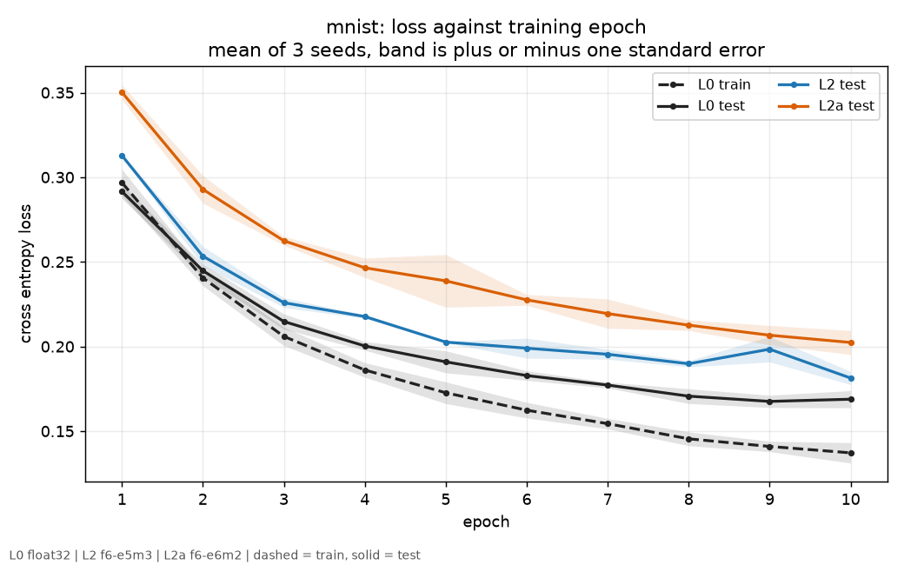
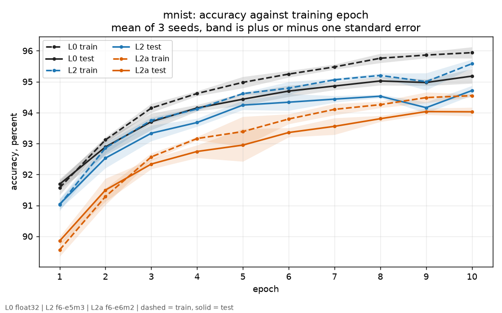
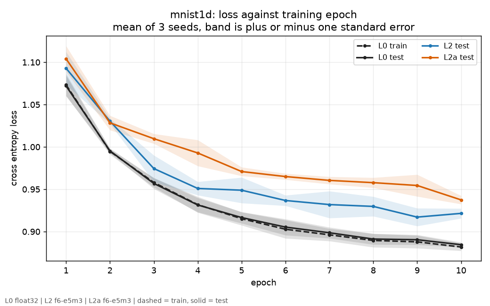
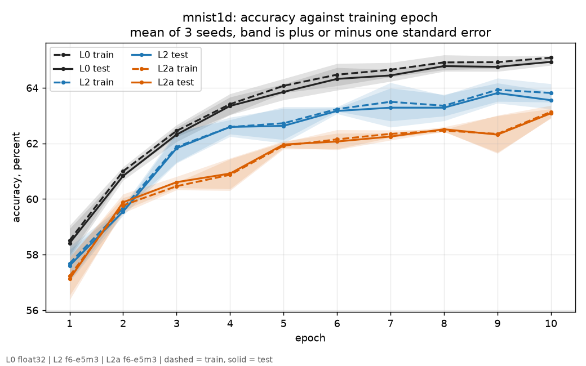

# Experiment L2

## Objective

This experiment aims to find the impact of FP4 E2M1 w. scaling factor E6M2 or E5M3 with amax/6 or four6 on the training by quantizing only the forward pass of the training process.

Every forward pass during the training will have it's weights quantized according to the specified FP4 format with the chosen scaling factor.

Then we will run the forward pass with those quantized weights. And compute the loss based on the output of that forward pass. Save the loss in FP64.

The backward pass will remain in full FP64 precision, ensuring the experiment can be compared to L1's 0th run of full FP64 training so we can see the impact of quantization on the forward pass.

L2 is the first phase of the experiment where the quantization acts during training. The weights are quantized again at every step (we don't touch the activations). L1 quantized one fixed set of weights (also didn't touch the activations) after training (**post-training quantization, PTQ**). L2 is, essentially, **quantization-aware training (QAT)**.

**We don't touch the activations during L2. We defer it to L2a, where we will specifically study the effect of quantizing activations in addition to the forward pass weights, isolating the impact of activation quantization from weight quantization.**

## Terms

|Term|Meaning|
|-|-|
|master weight|The FP64 copy of W that the optimizer updates. It is not on the FP4 grid.|
|Wq|The quantized copy of the master weight, decoded back to FP64. The forward pass uses Wq.|
|STE, straight-through estimator|A rule for the backward pass. The gradient flows through the quantizer as if the quantizer were the identity function. Formally: `dWq/dW := 1`.|
|paired seeds|The same seed, the same start weights and the same batch order in two runs. Only the option under test differs. Paired differences remove most of the seed noise.|

## Methodology

We will introduce multiple seeds to ensure our results aren't biased by a random initialization of the model weights. So far we used 42, 4242, and 424242. We will expand this to 10 seeds:

Our seeds will be 42, 4242, 424242, 123, 456, 789, 1010, 2020, 3030, and 4040.

1. Initialize the model with full FP64 precision weights.
2. For each forward pass during training, quantize the weights according to the specified FP4 format and chosen scaling factor.
3. Perform the forward pass using the quantized weights.
4. Compute the loss based on the forward pass output.
5. Perform the backward pass using full FP64 precision weights to update the model parameters.
6. Repeat steps 2-5 for the entire training process.
7. Evaluate the model's performance on a test set to assess the impact of forward pass quantization.
8. Compare the results with the baseline full FP64 training to quantify the effect of FP4 forward pass quantization.
9. Document any observed differences in training dynamics, convergence speed, and final model accuracy to provide a comprehensive analysis of the impact of forward pass quantization.

### Exact gradient rule (definition, do not vary it between runs)

The forward pass uses `Wq`. The backward pass computes `dL/dW` at the float master `W` (STE). It uses the activations that the quantized forward produced. The biases and the Adam state stay in FP64. The quantizer is treated as the identity in the backward pass.

We will create a run matrix for every experiment to systematically record the results for each combination of FP4 format, scaling factor, and seed, ensuring a comprehensive analysis of the impact of forward pass quantization.

This means the gradient never sees the quantization error of the weight. The gradient only sees its effect on the activations. This is the standard weight-quantization STE. L3 and L4 change exactly this rule, so it must be written down here.

### What L2 does not quantize

Activations stay in FP64. Biases stay in FP64. This is the same scope as L1, so L2 and L1 are comparable. The consequence: the L1 and L2 accuracies are **upper bounds** for real FP4 inference and training. Real hardware rounds the activations too.

**Decision needed (Dzemo):** the hardware MAC needs two FP4 operands. Choose one:
- **Option A (recommended):** L2 quantizes weights only. Activation quantization becomes its own step "L2a", with the same 4 configs, run after L2. Reason: one factor changes per rung, so the damage can be attributed.
- **Option B:** L2 crosses both factors, 8 configs (2 formats x 2 rules x weights-only/weights-and-activations). One longer run, attribution is weaker.

## Starting baseline

We pull the L0 baseline on MNIST and MNIST1D datasets

|seed|unquantized FP64 acc. MNIST|unquantized FP64 acc. MNIST1D|
|-|-|-|
|42|94.69%|65.15|
|4242|95.42%|64.87|
|424242|95.44%|65.31|
|average|95.18%|65.11|

|seed|unquantized FP64 test loss MNIST|unquantized FP64 test loss MNIST1D|
|-|-|-|
|average|0.1686|0.8834|

### Float width

The baselines above are float64. `python/fp32_probe.py` measured the same three seeds on the same code path in float32, changing nothing else:

|dataset|float64 mean|float32 mean|shift|seed spread of the float64 row|
|-|-:|-:|-:|-:|
|MNIST|95.18|95.18|+0.00|0.75|
|MNIST-1D|65.11|64.94|-0.17|0.44|

The shift is inside the seed spread on both datasets, so **float32 is the width of every run from here on**, and `train.DTYPE` is the one place that sets it. The three float64 rows above stay as history: a float64 row and a float32 row are not comparable, so the `L0` row of the run matrix is retrained in float32 for all ten seeds, and `l2_sweep.py` retrains any weight file whose width does not match instead of averaging the two.

From here we see that MNIST1D is a lot more sensitive than MNIST. That's why we have it included :)

## Run matrix

Every run uses: 784-16-16-10, Adam, lr 1e-3, batch 128, 10 epochs, dataset seed 42. Nothing is tuned. Each config runs on every seed below.

|Run name|Format|Rule|Seed count|
|-|-|-|-|
|`L0`|none|none|10|
|`L1a`|FP4 payload, FP64 scale|n/a|10 (reference row: the PTQ loss)|
|`L2-a6-e6m2`|E6M2|amax/6|10|
|`L2-f6-e6m2`|E6M2|four6|10|
|`L2-a6-e5m3`|E5M3|amax/6|10|
|`L2-f6-e5m3`|E5M3|four6|10|

Seeds: 42, 4242, 424242, 123, 456, 789, 1010, 2020, 3030, and 4040. Each dataset runs the whole matrix. Total: 6 rows x 10 seeds x 2 datasets = 120 runs, of which 100 need training.

`L1a` is the reference point that shows how much training recovers. `L0` is the reference point that shows what quantization costs.

## Decision rule (pre-registered, written before the run)

An option wins only if both conditions hold on **both** datasets:
1. The paired difference (same seed, L2 against L2) has the same sign in at least 8 of the 10 seeds.
2. The absolute mean paired difference is greater than 2 standard errors of that mean.

If the conditions do not hold, the result is **no decision**. The option stays open and moves to the next rung. Do not pick a default.

## What is logged

Per epoch, per seed, per run:
- train loss, train accuracy, test loss, test accuracy (from `model.evaluate`).
- SQNR of W1, W2, W3, measured on the quantized copy against the master, at the end of the epoch.
- The 4 counters of `scale_counters`: scale saturated, scale underflow, zero blocks, non-finite blocks.
- **New: number of steps where `Wq` did not change**, while the master weight did change. This is the mild form of the update problem, and it is a direct input for L3 and L7.

Expected under L2: the counters stay at 0. The L1 counters did (2,430 blocks, all zero). Weight bytes do not stress an 8-bit scale. Write the zeros down anyway, they are evidence.

## Expected outcomes (hypotheses, to be confirmed or rejected)

1. L2 is better than L1a on the same dataset. The weights adapt to the grid, so QAT recovers part of the PTQ loss. If L2 is worse than L1a, suspect a bug before suspecting a finding.
2. `four6` keeps its SQNR advantage (+0.8 to +1.0 dB, measured in L1). Whether it converts into accuracy is the open question.
3. E6M2 and E5M3 stay within noise of each other. The scale range is narrow (21 and 39 codes used of 255 in L1).
4. The counters stay at 0, so L2 cannot decide the format. The format decision needs gradients (L3, L4) and optimizer state (L6).

## Cost

Per training run: 625 steps per epoch x 10 epochs = 6,250 forward passes, so 6,250 quantizer calls per matrix. The quantizer cost is negligible against the GEMM.

|Dataset|One run, 10 epochs|100 runs|
|-|-|-|
|MNIST|about 20 s (estimate, from 30 s for the L0 run)|about 35 min|
|MNIST-1D|about 2.4 min (measured, L0)|about 4 h|

## Reproduction

```
cd FPG4/python
uv run python l2_sweep.py [mnist|mnist1d]     # script not written yet
uv run python tests/test_quant.py
```

Results go in `docs/experiment_L2.md`, section "Results", with the same table shape as `experiment_L1.md`.

## Open decisions

1. **Activations.** Option A (weights only in L2, activation quantization as a separate step) or Option B (8 crossed configs). See "What L2 does not quantize".
2. **Test set or validation split.** Step 7 uses "a test set", like L0 and L1. That keeps the numbers comparable, but the winner is then selected on the test set. A validation split out of train (for example 10% of the 400,000 MNIST-1D samples) would remove the selection bias but breaks comparability with L0 and L1. Recommendation: keep the test set for L2 and state the bias in the results.
3. **The cheap activation check.** Before any retraining, L1 can be rerun with quantized activations (no training, a few minutes). That gives the weight-only against weight+activation gap at inference, for the 4 configs, at the cost of one script. Recommendation: do it, it is the cheapest data we can get on the format question.

## Results

### Correction, and it voids the first version of this section

The first version of these results reported `evaluate(p, ...)`, where `p` is the float master weight. The master never reaches the fabric. The number that belongs here is `evaluate(pq, ...)`, the quantized model, and for L2a it is `evaluate(pq, X, y, quant=activation_hook)`.

| what was reported | what it was | what it should be |
|-|-|-|
| `L2` accuracy | the float master weight | the FP4 weight |
| `L2a` accuracy | the float master weight, on float activations | the FP4 weight on FP4 activations |

So the first L2 table measured a model the fabric never runs. It is withdrawn in full, together with the MNIST-1D L2 table and the `four6` verdict that came from it.

**Why the error moved the answer, and not only the number.** `four6` keeps the FP4 weights closer to the master than `amax/6` does, by 0.74 dB of SQNR (20.64 against 19.90 on W1). A float master with a smaller distance to its own quantization scores better in float. That is exactly what the wrong table showed, and it is why the wrong table promoted `four6` by a decided 0.42 points. **The advantage was the master's SQNR leaking into the reported accuracy. It is not an advantage of the quantized model.** The corrected numbers below do not reproduce it.

`python/qat.py` now evaluates the deployed model on both rungs, and `self_check()` checks two things that would have caught this: the quantizer is idempotent on its own output, and every activation tensor the forward pass hands the backward pass is already on the grid.

### MNIST, L2 and L2a, 10 seeds

Conditions: float32 (`train.DTYPE`), full test set, 10 epochs, batch 128, dataset seed 42, 784-16-16-10. Script `python/l2_sweep.py mnist 10 w` and `python/l2_sweep.py mnist 10 wa`. Every run is resumable in `out/w/mnist/` and `out/wa/mnist/`.

The rungs:

| rung | weights | activations | training |
|-|-|-|-|
| `L0` | float | float | no quantization |
| `L1a` | FP4, float64 scale | float | no, shares the L0 weights |
| `ptq` | FP4, 8-bit scale | float for L2, FP4 for L2a | no, shares the L0 weights |
| `L2` | FP4, quantized every step | float | quantization in the forward pass |
| `L2a` | FP4, quantized every step | FP4, quantized every step | quantization in the forward pass |

Mean over 10 seeds:

| rung | MNIST accuracy | drop against L0 |
|-|-:|-:|
| L0 | **95.01** | – |
| L1a | 92.65 | 2.37 |
| ptq for L2, a6-e6m2 / f6-e6m2 / a6-e5m3 / f6-e5m3 | 93.25 / 93.55 / 92.57 / 93.16 | 1.77 / 1.46 / 2.44 / 1.86 |
| **L2**, same order | **94.72 / 94.77 / 94.61 / 94.80** | **0.29 / 0.24 / 0.41 / 0.21** |
| ptq for L2a, same order | 90.70 / 91.63 / 90.28 / 91.28 | 4.31 / 3.39 / 4.74 / 3.74 |
| **L2a**, same order | **93.88 / 94.10 / 93.92 / 93.97** | **1.13 / 0.91 / 1.10 / 1.04** |

What training recovers:

|configuration|L2 ptq drop|L2 drop|recovered|L2a ptq drop|L2a drop|recovered|
|-|-:|-:|-:|-:|-:|-:|
|a6-e6m2|1.77|0.29|1.48|4.31|1.13|3.19|
|f6-e6m2|1.46|0.24|1.22|3.39|0.91|2.47|
|a6-e5m3|2.44|0.41|2.03|4.74|1.10|3.64|
|f6-e5m3|1.86|0.21|1.64|3.74|1.04|2.69|

**Per-seed accuracy, L2:**

|seed|L0|a6-e6m2|f6-e6m2|a6-e5m3|f6-e5m3|
|-|-:|-:|-:|-:|-:|
|42|94.71|94.56|94.34|95.06|94.42|
|4242|95.41|94.85|94.66|94.45|94.77|
|424242|95.42|94.91|94.98|94.94|94.95|
|123|94.89|94.50|94.60|93.96|94.25|
|456|94.79|94.74|94.66|94.27|95.03|
|789|94.66|94.81|94.90|94.89|94.87|
|1010|95.18|95.04|94.79|94.32|94.85|
|2020|95.37|94.40|94.88|94.90|95.04|
|3030|94.75|94.53|94.77|94.49|94.81|
|4040|94.95|94.90|95.13|94.80|95.00|
|**mean**|**95.01**|**94.72**|**94.77**|**94.61**|**94.80**|

**Per-seed accuracy, L2a:**

|seed|L0|a6-e6m2|f6-e6m2|a6-e5m3|f6-e5m3|
|-|-:|-:|-:|-:|-:|
|42|94.71|94.09|93.78|93.66|93.83|
|4242|95.41|94.00|94.03|94.37|94.28|
|424242|95.42|94.70|94.27|93.98|94.19|
|123|94.89|93.12|94.04|93.66|93.63|
|456|94.79|93.35|93.92|93.50|93.96|
|789|94.66|94.22|93.96|93.33|94.56|
|1010|95.18|94.10|94.09|94.00|93.75|
|2020|95.37|93.95|94.53|94.11|93.90|
|3030|94.75|93.78|94.09|94.00|93.80|
|4040|94.95|93.54|94.29|94.55|93.79|
|**mean**|**95.01**|**93.88**|**94.10**|**93.92**|**93.97**|

### The decision rule, applied to every pair

L2:

|a|b|mean a-b|standard error|sign agrees|condition 1|condition 2|winner|
|-|-|-:|-:|-:|-:|-:|-|
|L2 a6-e6m2|L0|-0.29|0.10|9/10|yes|yes|**L0**|
|L2 f6-e6m2|L0|-0.24|0.10|7/10|no|yes|no decision|
|L2 a6-e5m3|L0|-0.41|0.14|8/10|yes|yes|**L0**|
|L2 f6-e5m3|L0|-0.21|0.10|6/10|no|yes|no decision|
|L2 a6-e6m2|ptq a6-e6m2|+1.48|0.32|10/10|yes|yes|**L2**|
|L2 f6-e6m2|ptq f6-e6m2|+1.22|0.37|9/10|yes|yes|**L2**|
|L2 a6-e5m3|ptq a6-e5m3|+2.03|0.45|9/10|yes|yes|**L2**|
|L2 f6-e5m3|ptq f6-e5m3|+1.64|0.41|10/10|yes|yes|**L2**|
|L2 a6-e6m2|L2 f6-e6m2|-0.05|0.07|6/10|no|no|no decision|
|L2 a6-e5m3|L2 f6-e5m3|-0.19|0.12|8/10|yes|no|no decision|
|L2 a6-e6m2|L2 a6-e5m3|+0.12|0.13|6/10|no|no|no decision|
|L2 f6-e6m2|L2 f6-e5m3|-0.03|0.06|6/10|no|no|no decision|

L2a:

|a|b|mean a-b|standard error|sign agrees|condition 1|condition 2|winner|
|-|-|-:|-:|-:|-:|-:|-|
|L2a a6-e6m2|L0|-1.13|0.14|10/10|yes|yes|**L0**|
|L2a f6-e6m2|L0|-0.91|0.07|10/10|yes|yes|**L0**|
|L2a a6-e5m3|L0|-1.10|0.10|10/10|yes|yes|**L0**|
|L2a f6-e5m3|L0|-1.04|0.12|10/10|yes|yes|**L0**|
|L2a a6-e6m2|ptq a6-e6m2|+3.19|0.46|10/10|yes|yes|**L2a**|
|L2a f6-e6m2|ptq f6-e6m2|+2.47|0.47|10/10|yes|yes|**L2a**|
|L2a a6-e5m3|ptq a6-e5m3|+3.64|0.58|10/10|yes|yes|**L2a**|
|L2a f6-e5m3|ptq f6-e5m3|+2.69|0.51|10/10|yes|yes|**L2a**|
|L2a a6-e6m2|L2a f6-e6m2|-0.21|0.15|6/10|no|no|no decision|
|L2a a6-e5m3|L2a f6-e5m3|-0.05|0.17|4/10|no|no|no decision|
|L2a a6-e6m2|L2a a6-e5m3|-0.03|0.18|6/10|no|no|no decision|
|L2a f6-e6m2|L2a f6-e5m3|+0.13|0.12|6/10|no|no|no decision|

**Every comparison between two configurations is a `no decision` in L2a.** In L2 one pair reaches condition 1 and fails condition 2. The four configurations are inside each other's noise on MNIST at both rungs.

### What training does to the grid

End of training, mean over the 10 seeds. Two different numbers, and they must not be confused:

| measure | definition | size dependent |
|-|-|-|
| `stale` | the fraction of weight elements whose FP4 value did not change from one step to the next, while the master weight was free to move | no. It is a fraction over elements |
| `frozen steps` | the number of steps in the epoch in which the WHOLE matrix was bit-identical to the step before | **yes.** A matrix of 12,544 elements is much less likely to be fully frozen than a matrix of 160 elements |

So `frozen steps` is reported per matrix and never summed. `W1` has 12,544 elements and is almost never fully frozen. `W3` has 160 and is fully frozen in 40 percent of the steps. A sum over the three matrices would be a statistic of the small matrices.

One correction to the counts below: an earlier version of this section summed the three matrices into one number and compared it with 469, which is the step count of a single matrix. Every per-matrix count below also carries one artificial freeze per epoch, because the code refreshed its reference tensor at the end of each epoch and then compared it with itself. `qat.py` no longer refreshes it, so new runs are clean. The table subtracts the one artificial count.

MNIST, 469 steps in an epoch:

|rung|configuration|stale W1|stale W2|stale W3|frozen W1|frozen W2|frozen W3|
|-|-|-:|-:|-:|-:|-:|-:|
|L2|a6-e5m3|98.99%|99.07%|98.88%|0|120.4|179.3|
|L2|f6-e5m3|98.29%|97.95%|97.83%|0|128.1|205.9|
|L2a|a6-e5m3|99.09%|99.03%|98.46%|0|133.1|135.4|
|L2a|f6-e5m3|98.44%|98.15%|97.54%|0|133.5|172.6|

**98 to 99 percent of the weight elements never move their FP4 value. `four6` remains the configuration with the most frozen weights** on both datasets and both rungs.

### Activation SQNR, L2a

Mean over the 10 seeds at the end of training. The input is 784 wide and is quantized once, outside the loop, because a block lives inside one row and rows never mix. That claim is proved at run time: `check_prequant_equivalence()` quantizes 4,096 rows in one call and again in 32 batches of 128, and the two results must be bit-identical. Measured worst difference: 0.

|configuration|input X|A1|A2|
|-|-:|-:|-:|
|a6-e6m2|22.83|20.45|20.52|
|f6-e6m2|25.82|21.41|21.53|
|a6-e5m3|22.68|20.76|20.88|
|f6-e5m3|25.36|21.73|21.84|

**The input is the best-preserved tensor, not the worst.** That is the opposite of what a first guess would say, and it is why the four tensors are reported separately.

### Scale counters

On the weights, summed over every epoch of every seed and configuration: `scale_saturated` 0, `scale_underflow` 0, `zero_blocks` 0, `nonfinite_blocks` 0. The same as the L1 measurement.

On the activations, in L2a, same sum: `scale_saturated` 0, `scale_underflow` 0, **`zero_blocks` 6**, `nonfinite_blocks` 0.

**This is the first non-zero counter in the project.** ReLU produces all-zero blocks, and a weight matrix never does. **The zero-block path of the encoder is exercised by activations and by nothing else**, which is a fact for the RTL and not a hypothesis.

### Findings on MNIST

1. **Weight-only FP4 QAT costs 0.21 to 0.41 points.** Two of the four configurations are statistically indistinguishable from the float baseline; the other two are decided, in favour of L0, by 0.29 and 0.41 points.
2. **Weights and activations together cost 0.91 to 1.13 points, and all four configurations are decided.** So the activation half of the MAC costs about 3 times the weight half on MNIST: 1.13 against 0.29 for the same rule.
3. **Training recovers 1.2 to 2.0 points in L2 and 2.5 to 3.6 in L2a.** The more the rung quantizes, the more training has to give back, and every one of those comparisons is decided in favour of training.
4. **The two scale formats are not separated at either rung.** Under either rule, on either rung, the answer is no decision.
5. **`four6` against `amax/6` is not separated at either rung.** The decided 0.42 points that the first version of this section reported was the float master's SQNR, and it is withdrawn.
6. **The best configuration is `f6-e5m3` on both rungs** (94.80 and 93.97), and the worst is `a6-e5m3` on L2 (94.61) and `a6-e6m2` on L2a (93.88). The whole spread is 0.19 and 0.22 points.
7. **The staleness problem survives every correction.** It is measured on the optimizer and not on the evaluated model, so the fix did not touch it.

### MNIST-1D, L2 and L2a, 10 seeds

Same conditions: float32, full 100,000-sample test set, 10 epochs, batch 128. One epoch is 3,125 steps.

| rung | accuracy, four configurations in the order a6-e6m2 / f6-e6m2 / a6-e5m3 / f6-e5m3 | drop against L0 |
|-|-:|-:|
| L0 | **64.98** | – |
| L1a | 56.77 | 8.21 |
| ptq for L2 | 54.96 / 56.19 / 56.28 / 57.01 | 10.02 / 8.79 / 8.70 / 7.97 |
| **L2** | **63.26 / 63.35 / 63.26 / 63.55** | **1.71 / 1.63 / 1.72 / 1.42** |
| ptq for L2a | 52.01 / 53.40 / 53.60 / 54.50 | 12.97 / 11.58 / 11.38 / 10.48 |
| **L2a** | **62.30 / 62.29 / 62.48 / 62.66** | **2.68 / 2.68 / 2.50 / 2.32** |

What training recovers:

|configuration|L2 ptq drop|L2 drop|recovered|L2a ptq drop|L2a drop|recovered|
|-|-:|-:|-:|-:|-:|-:|
|a6-e6m2|10.02|1.71|8.31|12.97|2.68|10.29|
|f6-e6m2|8.79|1.63|7.16|11.58|2.68|8.90|
|a6-e5m3|8.70|1.72|6.98|11.38|2.50|8.87|
|f6-e5m3|7.97|1.42|6.54|10.48|2.32|8.16|

Per-seed accuracy, L2:

|seed|L0|a6-e6m2|f6-e6m2|a6-e5m3|f6-e5m3|
|-|-:|-:|-:|-:|-:|
|42|64.89|63.34|63.69|63.52|63.63|
|4242|64.75|63.33|63.13|62.95|62.98|
|424242|65.17|63.27|64.22|63.81|64.06|
|123|64.44|63.96|63.04|62.31|62.87|
|456|64.86|64.16|61.24|62.69|63.50|
|789|64.43|63.48|62.78|63.68|63.10|
|1010|65.33|62.93|62.27|63.20|63.88|
|2020|65.12|64.02|64.20|63.96|63.91|
|3030|66.33|61.38|64.30|63.46|63.67|
|4040|64.45|62.80|64.65|63.02|63.93|
|**mean**|**64.98**|**63.26**|**63.35**|**63.26**|**63.55**|

Per-seed accuracy, L2a:

|seed|L0|a6-e6m2|f6-e6m2|a6-e5m3|f6-e5m3|
|-|-:|-:|-:|-:|-:|
|42|64.89|62.49|63.03|61.50|62.85|
|4242|64.75|62.46|62.44|62.76|63.39|
|424242|65.17|61.95|60.66|62.53|63.01|
|123|64.44|61.83|62.02|61.78|62.18|
|456|64.86|62.56|62.73|63.69|61.93|
|789|64.43|62.73|62.50|61.61|60.82|
|1010|65.33|62.04|62.29|62.32|62.95|
|2020|65.12|62.47|62.82|63.90|62.71|
|3030|66.33|61.93|62.71|62.90|62.79|
|4040|64.45|62.54|61.74|61.77|63.92|
|**mean**|**64.98**|**62.30**|**62.29**|**62.48**|**62.66**|

The decision rule, applied to every pair:

L2:

|a|b|mean a-b|standard error|sign agrees|condition 1|condition 2|winner|
|-|-|-:|-:|-:|-:|-:|-|
|L2 a6-e6m2|L0|-1.71|0.40|10/10|yes|yes|**L0**|
|L2 f6-e6m2|L0|-1.63|0.34|9/10|yes|yes|**L0**|
|L2 a6-e5m3|L0|-1.72|0.20|10/10|yes|yes|**L0**|
|L2 f6-e5m3|L0|-1.42|0.17|10/10|yes|yes|**L0**|
|L2 a6-e6m2|ptq a6-e6m2|+8.31|1.54|10/10|yes|yes|**L2**|
|L2 f6-e6m2|ptq f6-e6m2|+7.16|1.18|10/10|yes|yes|**L2**|
|L2 a6-e5m3|ptq a6-e5m3|+6.98|1.06|10/10|yes|yes|**L2**|
|L2 f6-e5m3|ptq f6-e5m3|+6.54|1.00|10/10|yes|yes|**L2**|
|L2 a6-e6m2|L2 f6-e6m2|-0.09|0.51|5/10|no|no|no decision|
|**L2 a6-e5m3**|**L2 f6-e5m3**|**-0.29**|**0.14**|**8/10**|**yes**|**yes**|**four6**|
|L2 a6-e6m2|L2 a6-e5m3|+0.00|0.33|4/10|no|no|no decision|
|L2 f6-e6m2|L2 f6-e5m3|-0.20|0.31|3/10|no|no|no decision|

L2a:

|a|b|mean a-b|standard error|sign agrees|condition 1|condition 2|winner|
|-|-|-:|-:|-:|-:|-:|-|
|L2a a6-e6m2|L0|-2.68|0.25|10/10|yes|yes|**L0**|
|L2a f6-e6m2|L0|-2.68|0.26|10/10|yes|yes|**L0**|
|L2a a6-e5m3|L0|-2.50|0.25|10/10|yes|yes|**L0**|
|L2a f6-e5m3|L0|-2.32|0.29|10/10|yes|yes|**L0**|
|L2a a6-e6m2|ptq a6-e6m2|+10.29|1.29|10/10|yes|yes|**L2a**|
|L2a f6-e6m2|ptq f6-e6m2|+8.90|1.19|10/10|yes|yes|**L2a**|
|L2a a6-e5m3|ptq a6-e5m3|+8.87|0.88|10/10|yes|yes|**L2a**|
|L2a f6-e5m3|ptq f6-e5m3|+8.16|0.85|10/10|yes|yes|**L2a**|
|L2a a6-e6m2|L2a f6-e6m2|+0.01|0.20|4/10|no|no|no decision|
|L2a a6-e5m3|L2a f6-e5m3|-0.18|0.37|6/10|no|no|no decision|
|L2a a6-e6m2|L2a a6-e5m3|-0.17|0.29|6/10|no|no|no decision|
|L2a f6-e6m2|L2a f6-e5m3|-0.36|0.39|6/10|no|no|no decision|

Stale weights and frozen steps, mean over the 10 seeds, 3,125 steps in an epoch:

|rung|configuration|stale W1|stale W2|stale W3|frozen W1|frozen W2|frozen W3|
|-|-|-:|-:|-:|-:|-:|-:|
|L2|a6-e5m3|97.47%|97.80%|97.81%|0|110.8|400.1|
|L2|f6-e5m3|96.34%|95.92%|95.81%|0|203.9|662.8|
|L2a|a6-e5m3|98.21%|97.68%|97.23%|0|94.4|260.6|
|L2a|f6-e5m3|97.12%|95.76%|95.10%|0|182.3|490.7|

Activation SQNR, L2a:

|configuration|input X|A1|A2|
|-|-:|-:|-:|
|a6-e6m2|20.53|20.94|21.22|
|f6-e6m2|23.07|22.04|22.48|
|a6-e5m3|21.02|21.41|22.11|
|f6-e5m3|23.17|22.53|23.11|

**On MNIST-1D the input is the worst tensor of the three, and on MNIST it is the best.** So the ordering of the three tensors is a property of the dataset and not of the format, and no single pooled SQNR number can stand for the activation cost.

Scale counters, activations, summed over every epoch of every seed and configuration: `scale_saturated` 0, `scale_underflow` 0, **`zero_blocks` 304**, `nonfinite_blocks` 0. The weights give 0 on all four, as on MNIST.

### The verdict of L2 and L2a, both datasets

The pre-registered rule needs both conditions on **both** datasets, so a row is decided only when MNIST and MNIST-1D agree. There are four comparisons for a rule or a format, and each one is measured four times: L2 and L2a, on two datasets.

|question|MNIST L2|MNIST-1D L2|MNIST L2a|MNIST-1D L2a|verdict|
|-|-|-|-|-|-|
|`four6` against `amax/6`, UE5M3|no decision, 8/10 signs, condition 2 fails|-0.29, decided|no decision|-0.18, no decision|**no decision. One of four cells passes**|
|`four6` against `amax/6`, UE6M2|-0.05, no decision|-0.09, no decision|+0.01, no decision|-0.21, no decision|**no decision**|
|UE6M2 against UE5M3 under `amax/6`|+0.12, no decision|+0.00, no decision|-0.03, no decision|-0.17, no decision|**no decision**|
|UE6M2 against UE5M3 under `four6`|-0.03, no decision|-0.20, no decision|+0.13, no decision|-0.36, no decision|**no decision**|

**So L1, L1d, L2 and L2a, on two datasets and ten seeds, do not separate the two scale formats, and do not separate the two scale rules.** Sixteen comparisons, one decided cell. The `four6` cell that is decided points the same way as the withdrawn result, and it is one cell out of four, so the rule keeps the option open and moves both rules and both formats to the next rung.

**That is the result of L2 and L2a.** The format question is not answered by accuracy under quantization-aware training. It moves to the gradients.

### What L2 and L2a do settle

|finding|evidence|
|-|-|
|an FP4 forward pass with a float32 trainer works|weight-only drop 0.21 to 0.41 points on MNIST, 1.42 to 1.72 on MNIST-1D, all decided|
|the activation half of the MAC costs more than the weight half|on MNIST, 1.13 against 0.29 points for the same rule. On MNIST-1D, 2.50 against 1.71|
|training recovers most of the PTQ loss|1.2 to 2.0 points in L2, 2.5 to 3.6 in L2a on MNIST, and 6.5 to 10.3 in L2a on MNIST-1D|
|the input is not the worst tensor|it is the best on MNIST and the worst on MNIST-1D, so it must be measured per dataset|
|the zero-block path is a real path|6 zero blocks on MNIST activations, 304 on MNIST-1D, 0 on weights anywhere|
|the optimizer cannot follow the grid|96 to 99 percent of the weight elements do not move their FP4 value per step, and the whole matrix is bit-identical to the step before in up to 44 percent of the steps (W3 on MNIST under `f6-e5m3`, 206 of 469)|

## The curves

Two figures per dataset. The x axis is the training epoch, 1 to 10. The y axis is either the cross entropy loss or the accuracy. Each figure holds six curves: three rungs, each with its training curve dashed and its test curve solid.

|file|content|
|-|-|
|`out/curves_mnist_loss.png`|MNIST, loss against epoch, L0 and L2 and L2a|
|`out/curves_mnist_acc.png`|MNIST, accuracy against epoch, the same three runs|
|`out/curves_mnist1d_loss.png`|MNIST-1D, loss against epoch|
|`out/curves_mnist1d_acc.png`|MNIST-1D, accuracy against epoch|
|`out/curves_<dataset>.json`|the same numbers, mean per epoch, so the figures are not the only record|
|`python/l0_history.json`|the L0 per-epoch history of the three seeds below|
|`python/curves.py`|the script that draws all of them. **It trains nothing**|

The four figures are also copied into this folder by `curves.py`, so they can be shown here. The copy is made by the script and is never edited by hand.

**MNIST, loss and accuracy**





**MNIST-1D, loss and accuracy**





### Two limits of the data, and neither is filled in

**1. The figures average three seeds, not ten.**
The L2 and L2a runs store their full per-epoch history for all ten seeds. The L0 runs do not: `train()` returns the history and prints one line per epoch, but the L0 runs never saved the return value. The only surviving L0 per-epoch record is the log of `python/fp32_probe.py`, which trained L0 in float32 for the seeds 42, 4242 and 424242 with the same protocol. That log was parsed into `python/l0_history.json`. The figures therefore use the three seeds that all three rungs share, so the gap between the curves is the rung and not the seed set.

**2. L2 and L2a have no training-loss curve.**
`python/l2_sweep.py` stored `test_loss`, `test_acc` and `train_acc` per epoch. It did not store `train_loss`, so that curve does not exist anywhere and it is not drawn. The loss figure therefore holds L0 train, L0 test, L2 test and L2a test. Train loss for L2 and L2a needs one 10-epoch run per rung to produce, and it has not been run.

### The configuration drawn

The rule is mechanical: the highest mean final test accuracy over the ten available seeds, and the lower mean final test loss when two configurations sit inside 0.01 accuracy points of each other.

|dataset|rung|config drawn|
|-|-|-|
|MNIST|L2|`f6-e5m3`, 94.80 percent, loss 0.1799|
|MNIST|L2a|`f6-e6m2`, 94.10 percent, loss 0.2001|
|MNIST-1D|L2|`f6-e5m3`, 63.55 percent, loss 0.9242|
|MNIST-1D|L2a|`f6-e5m3`, 62.66 percent, loss 0.9488|

**The best configuration is not the same on both MNIST rungs.** `f6-e5m3` wins L2 and `f6-e6m2` wins L2a, and the two are inside 0.3 points of each other at both rungs. That is the same "no decision" that this document already recorded.

### What the curves show

|observation|MNIST|MNIST-1D|
|-|-|-|
|the order of the three loss curves|L0 lowest, then L2, then L2a, and it never inverts|the same|
|the order of the three accuracy curves|the same, and it never inverts|the same|
|the last-epoch slope of the test loss|falling on all three rungs|falling on all three rungs|
|the training gap of L2 at epoch 10|0.87 points|0.26 points|
|the training gap of L2a at epoch 10|0.52 points|0.05 points|

**"Training gap" is train accuracy minus test accuracy at the last epoch.** It is the usual first sign of overfitting. It stays under one point everywhere, and it is smaller on the quantized rungs than on L0, so the grid regularizes.

**Nothing has flattened at epoch 10.** A 20-epoch probe on one MNIST seed gave both L0 and L2 about 0.8 more points, so the absolute numbers in this document are about 0.8 points below what this architecture reaches. The gaps between the rungs did not change in that probe, so the comparisons below stand.

### What is characteristic of a quantized curve, and what is not

**"Jitter" is the mean absolute change of the test accuracy from one epoch to the next, from epoch 4 to epoch 10, computed per seed and then averaged.** Epochs 1 to 3 are left out because every rung gains more than a point per epoch there, and that gain is the fit, not the step.

|dataset|L0|L2|L2a|
|-|-:|-:|-:|
|MNIST|**0.201**|0.367|0.361|
|MNIST-1D|**0.341**|0.636|0.663|

**The quantized models move about 1.8 times further between two epochs than the float model.** The same table is printed by `python/curves.py` and stored in `out/curves_<dataset>.json`.

**The jitter is invisible in the mean curve and it is the band that shows it.** The three seeds move in different directions at the same epoch, so their mean stays smooth while each seed steps. One seed of L2 on MNIST-1D reads 64.45, 62.97, 64.49, 64.06 across four epochs. That is a fall of 1.48 points and a rise of 1.52 points, on a curve whose total gain is under 4 points.

**The reversals that the mean does show:**

|where|the movement|
|-|-|
|MNIST accuracy, L2|94.44, 94.53, **94.16**, 94.71. A fall of 0.37 at epoch 9 and a rise of 0.55 after it|
|MNIST loss, L2|0.1898, **0.1984**, 0.1814. It rises by 0.0086 and then falls by 0.0170|
|MNIST-1D accuracy, L2|flat from epoch 4 to epoch 8 at 62.59, 62.63, 63.17, 63.29, 63.29, then 63.81|

**L0 never does this.** Its largest single-epoch reversal on MNIST is 0.05 points, which is seven times smaller than the 0.37 reversal of L2.

**The standard error of the mean curve is wider on the quantized rungs for the same reason.**

|dataset|series|L0|L2|L2a|
|-|-|-:|-:|-:|
|MNIST|test loss|0.0039|0.0033|0.0064|
|MNIST-1D|test loss|0.0067|0.0111|0.0082|
|MNIST-1D|test accuracy|0.263|0.417|0.327|

### Three things the shape of the curves settles

|what the figure shows|the evidence|
|-|-|
|**no crossing**|L0 is above L2 and L2 is above L2a at every one of the 10 epochs, on both datasets. The order is already there at epoch 1, at 91.69, 91.04 and 89.85. **Quantization is an offset, not a delay.** The quantized model does not start late and catch up, it follows the same shape lower down|
|**no distortion of the shape**|all three rungs have the same shape: a fast drop to epoch 3 or 4, then a long slow tail. The optimizer path is shifted, not bent|
|**no overfitting on the quantized rungs**|on the MNIST loss figure the L0 train curve still falls to 0.1372 at epoch 10 while its test curve turns up from 0.1676 to 0.1688. **That pair is the first sign of overfitting, and only L0 shows it.** L2 falls 0.0170 in its last epoch and L2a falls 0.0043|

**L2a recovers the most of the three, because it starts lowest.** On MNIST it goes from 89.85 to 94.03, a gain of 4.18 points, against L0's 91.69 to 95.18, a gain of 3.49.

### The jitter and the frozen weights are one fact seen at two levels

|level|what moves in steps|
|-|-|
|inside the training loop|98 to 99 percent of the weight elements keep the same FP4 value from one step to the next. The master moves every step and the fabric does not see it|
|at the output of the training loop|the test accuracy stays still for several epochs and then moves one step|

**The jaggedness in the figures is the frozen weight matrix, seen from outside.** A block of weights crosses its grid lines in a burst, so the loss and the accuracy move in a burst. Float moves a little at every step, so its curve is smooth. **This is the measurement that L3 is expected to make worse and that L7 exists to fix.**
